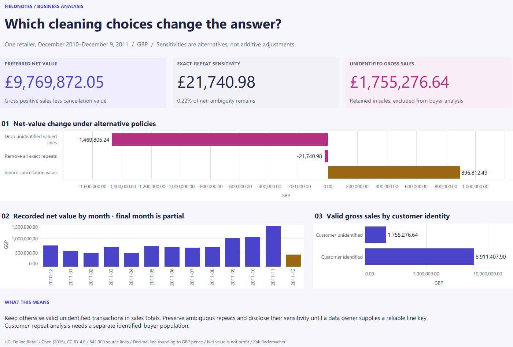

# Retail Sales and Data Quality

Cleaning a retail export can change the reported sales figure. I used this project to make those choices visible: what happens when customer IDs are missing, repeated lines might be legitimate, and cancellations belong in the total?

Python and SQLite process **541,909 invoice lines**. A **Tableau brief** compares the cleaning policies, and an Excel workbook provides a closer review of the results.

[View the Tableau report](deliverables/tableau-retail-preview.png) · [Download the workbook](deliverables/Retail%20Data%20Quality%20Review.twbx) · [Read the case study](docs/CASE_STUDY.md)



## What I found

The preferred policy gives **£9,769,872.05 in net transaction value**: **£10,666,684.54** in gross positive sales less **£896,812.49** in cancellations.

- Missing customer IDs don't invalidate the sales amount. Those records contribute to sales totals, while identified-customer analysis uses a narrower population.
- Removing later exact repeats would reduce net value by **£21,740.98**. I report that as a sensitivity rather than assume every repeat is an error, because the source has no unique line ID.
- Cancellations stay as negative amounts. Removing them would overstate net value; the source doesn't reliably link each one to a previous purchase.

December 2011 ends on December 9, so its lower total isn't a full-month sales decline. Net transaction value also isn't profit or collected cash. [Method and definitions](docs/METHOD.md).

## Inspect the work

[Excel review](deliverables/retail-sales-review.xlsx) · [PDF briefing](deliverables/case-study.pdf) · [SQL reports](sql) · [Product ranking query](sql/products.sql) · [Results](results/analysis.json)

The Tableau workbook includes its reporting data. Its written findings describe a fixed historical comparison; filtering an individual worksheet doesn't rewrite the text. [Tableau guide](tableau/README.md) · [Report definitions](docs/TABLEAU_REVIEW.md).

## Inspect or reproduce

From the repository root, with Python 3.10+:

```sh
python src/download_data.py
python src/pipeline.py
python -m unittest discover -s tests -v
```

The pipeline retains source records and records the decisions behind the reporting population. Monthly, country, and product totals reconcile in integer pence.

New runs publish through `results/latest.json`. Run `python src/publication.py` to find the current database, CSVs, and analysis record. Checked-in root-level results are the historical reference. [Results and recovery](docs/RESULT_VERSIONS.md).

## Documentation

- [Operating guide](docs/PROJECT_GUIDE.md) · [Data dictionary](docs/DATA_DICTIONARY.md) · [Excel guide](docs/EXCEL_GUIDE.md)
- [Verification](docs/QA_REPORT.md) · [Walkthrough](docs/PROJECT_WALKTHROUGH.md) · [Sources](docs/SOURCES.md)
- [Cover](deliverables/portfolio-cover-wide.png) · [Motion preview](deliverables/portfolio-motion.webm) · [Visual maintenance](docs/VISUAL_DESIGN.md)

To build the compact project bundle, run `python tools/package_project.py`.

This independent project uses Kaggle's mirror of UCI Online Retail, covering December 2010–December 9, 2011. Amounts are GBP; each line is rounded half up to pence. Original code: [MIT](LICENSE). The underlying data retains its source license and attribution.
