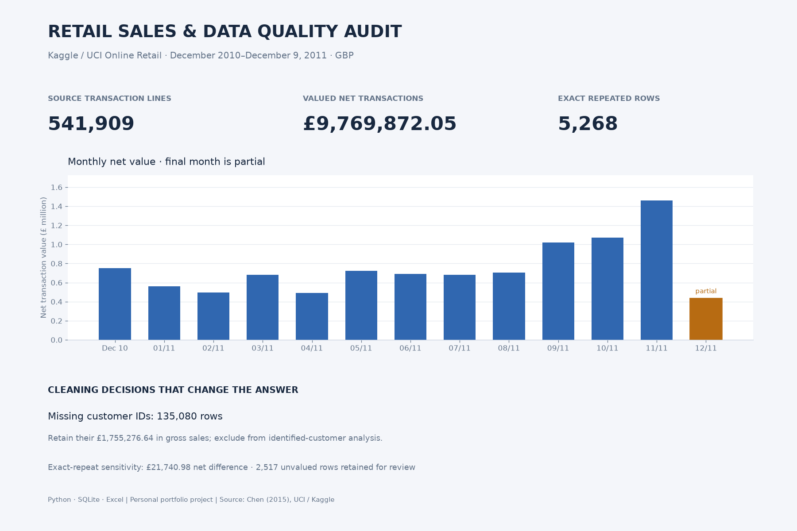

# Retail Sales & Data Quality Audit

A portfolio case study using **541,909 actual transaction lines** from Kaggle's E-Commerce Data, a mirror of UCI Online Retail. The deliverable turns a messy transaction export into a traceable Python/SQLite workflow, CSV reports, an Excel review workbook and a concise business case study.



## Skills demonstrated

| Work a client might need | Evidence in this project |
|---|---|
| Clean a messy CSV export | Explicit validation, source-row lineage, repeat flags and an exception report |
| Produce accurate sales reports | Six SQL reports and integer-pence reconciliation across monthly, country and product totals |
| Automate repeatable work | Standard-library Python CLI; original source preserved; reproducible download and run commands |
| Deliver usable Excel files | Formula-based review workbook, editable chart and documented refresh workflow |
| Explain findings and limits | Two-page PDF, case study, data dictionary, source attribution and QA evidence |

**Status:** personal portfolio project. This is not a paid client engagement, Albertsons data, or a claim of verified business savings. Analysis date: October 15, 2026. The source transactions are historical (December 2010 to December 9, 2011).

## Start here

- `deliverables/case-study.pdf`: concise visual explanation for a prospective client.
- `deliverables/retail-sales-review.xlsx`: editable Excel report with formulas and a native chart.
- `deliverables/report.html`: standalone report, open locally in a browser.
- `docs/METHOD.md`: cleaning decisions, measurement definitions and limitations.
- `docs/DATA_DICTIONARY.md`: source and output schemas.
- `docs/QA_REPORT.md`: executed checks and independent validation.
- `docs/EXCEL_GUIDE.md`: workbook formulas and refresh instructions.
- `docs/PROJECT_WALKTHROUGH.md`: explanation of the code and SQL for reviewing the project.
- `docs/SOURCES.md`: source links, citation, license and input fingerprint.

## Reproduce the analysis

Python 3.10 or later; the download, cleaning and SQL analysis use the standard library only. Commands below work from the project folder on Windows, macOS and Linux. Use `python3` instead of `python` where needed.

```sh
python src/download_data.py
python src/pipeline.py
python -m unittest discover -s tests -v
```

If Kaggle requires authentication or its public endpoint changes, download `data.csv` using the source page and place it in `data/raw/`, then run the remaining commands. Do not put account tokens in this repository. The download script does not execute content from the dataset.

```sh
# Custom input/output locations, same required column schema:
python src/pipeline.py --input data/raw/data.csv --output results
# Rebuild the PDF, chart images, HTML and Markdown documentation:
python -m pip install -r requirements-visuals.txt
python src/build_presentation.py
```

Optional independent verification uses `requirements-qa.txt`: install those packages, then run `python tools/verify_outputs.py`. This independently recomputes key source metrics with pandas, checks SQLite integrity, and inspects Excel formulas, cached values and chart bindings without changing the workbook. `python tools/package_project.py` rebuilds the compact ZIP after all outputs are ready.

`results/analysis.json` is the machine-readable record of metrics and reconciliation results. Six SQL files generate monthly sales, country totals, product rankings, repeat-customer groups, exclusions and overlapping quality flags. `results/retail.sqlite`, the full cleaned CSV and full raw input are generated locally; the compact portfolio ZIP omits these large files. The ZIP contains every aggregate report plus a 1,000-row cleaned example; rerunning the download and pipeline recovers the full dataset and database.

## Important definitions

- Main reporting retains exact repeated rows because a line-level unique identifier is absent. A separate deduplicated sensitivity quantifies their effect.
- Positive-price sale lines and cancellation lines are valued. Zero/negative-price records are excluded from the valued report but remain in the database and exception file.
- Missing customer IDs remain in sales totals. Customer repeat analysis only covers identified customers with purchase invoices.
- Amounts are GBP, rounded **per line** to pence with decimal half-up rounding. Net value is gross positive sales less cancellation value. It is not profit, cash collected or a return cohort rate.
- December 2011 is a partial month. Do not compare it directly with a complete month's performance.

## Excel rebuild

The delivered workbook opens in Excel without Python. Its formulas and chart recalculate from the monthly input table. See `docs/EXCEL_GUIDE.md` for manual refresh. `tools/build_workbook.mjs` reproduces the formatted workbook in a Codex environment with `@oai/artifact-tool`; this optional authoring dependency is separate from the portable Python analysis.

## Source and rights

Kaggle mirror: https://www.kaggle.com/datasets/carrie1/ecommerce-data

Original: Chen, D. (2015). *Online Retail* [Dataset]. UCI Machine Learning Repository. https://doi.org/10.24432/C5BW33. UCI lists CC BY 4.0; Kaggle's mirror currently lists the license as Unknown. Reuse of underlying data is attributed to the original UCI source, with transformations documented. Original code is MIT licensed; underlying data retains its source license. See `docs/SOURCES.md` and `LICENSE`.
