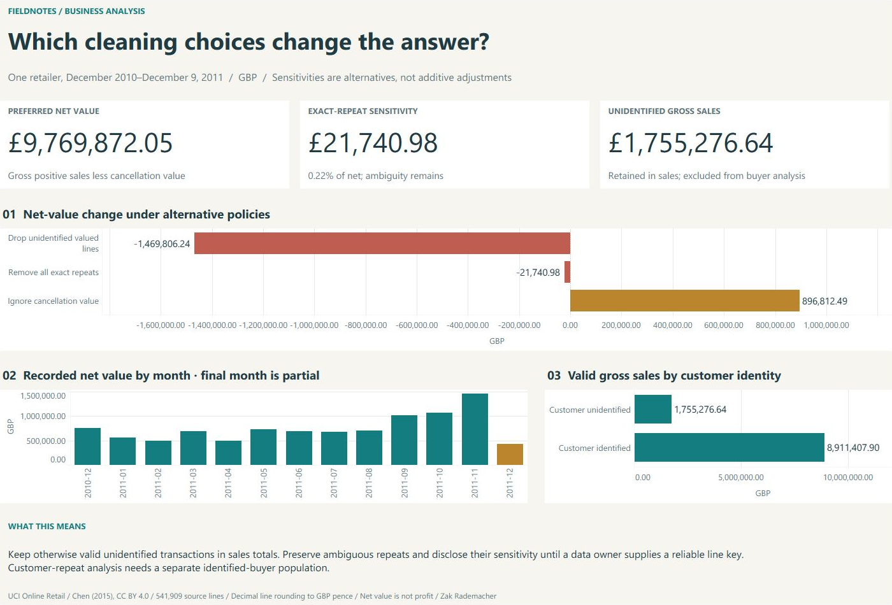

# Retail Sales & Data Quality Audit

   

**How do cleaning and duplicate-handling decisions affect reported sales?**

A **Python/SQLite** audit of **541,909 historical retail transaction lines**, with a Tableau cleaning-policy decision brief, an Excel review workbook, six SQL reports and source-row traceability.

**Updated Tableau decision brief:** [View the full-size preview](deliverables/tableau-retail-preview.png) · [Definitions and scope](docs/TABLEAU_REVIEW.md). The workbook remains local; it is not included in this repository.



[Read the case study](deliverables/case-study.pdf) · [Open the Excel review](deliverables/retail-sales-review.xlsx) · [Inspect the cleaning method](docs/METHOD.md)

## Analytical decisions

- Retain missing customer IDs in sales totals; limit customer-repeat analysis to identified customers with purchase invoices.
- Preserve exact repeated rows when no unique line identifier exists, and quantify a separate deduplicated sensitivity.
- Distinguish positive sales from cancellation value and reconcile integer-pence totals across monthly, country and product reports.

This project demonstrates data-quality judgment and reconciliation. December 2011 is a partial month, and net sales value is not profit, collected cash or a return cohort rate.

## Inspect or reproduce

[Python pipeline](src/pipeline.py) · [SQL reports](sql) · [Product ranking with a window function](sql/products.sql) · [Results and reconciliations](results/analysis.json)

From the repository root, with Python 3.10+:

```sh
python src/download_data.py
python src/pipeline.py
python -m unittest discover -s tests -v
```

## Supporting documentation

- [Reproduction, definitions and workbook rebuild](docs/PROJECT_GUIDE.md)
- [Data dictionary](docs/DATA_DICTIONARY.md) · [Excel guide](docs/EXCEL_GUIDE.md)
- [QA record](docs/QA_REPORT.md) · [Project walkthrough](docs/PROJECT_WALKTHROUGH.md)
- [Source and licensing](docs/SOURCES.md)
- [Bundle builder](tools/package_project.py): run `python tools/package_project.py` to create `retail-data-portfolio.zip`.

## Current results and recovery

New runs publish a complete version through `results/latest.json`. Run `python src/publication.py` to locate the current database, CSVs and analysis record. Checked-in root-level results remain historical reference files. [Versioned results and recovery](docs/RESULT_VERSIONS.md) explains failure handling and rebuilds.

## Scope

Independent portfolio project using Kaggle's mirror of UCI Online Retail, covering December 2010–December 9, 2011. Amounts are GBP, rounded per line to pence using decimal half-up rounding. Source/licensing details and workbook-generation dependencies are documented in the guides above.

Original code: [MIT](LICENSE). Underlying data retains its source license and attribution.

