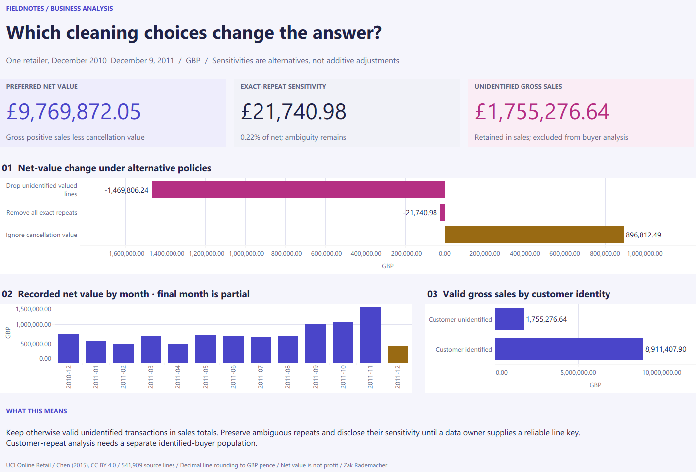

# Retail Data Quality Review — Tableau guide

**Question:** Which cleaning choices change the reported answer?

Preferred net value is GBP 9,769,872.05. Removing unidentified valued lines changes net by minus GBP 1,469,806.24; removing exact repeats changes it by minus GBP 21,740.98. These separate policy sensitivities are not additive. December 2011 is partial.

The brief uses validated Python/SQL aggregates for one fixed historical population. The KPI and written interpretation stay fixed when an individual worksheet is filtered. The native workbook was opened and checked in Tableau Desktop on October 29, 2026. [Download the packaged workbook](../deliverables/Retail%20Data%20Quality%20Review.twbx), including its reporting data, or use the [editable source and reproduction guide](../tableau/README.md). There is no Tableau Public deployment.

The repository overview links to the analysis, companion files, and source instructions. Data attribution and licensing still apply to the packaged reporting data.
